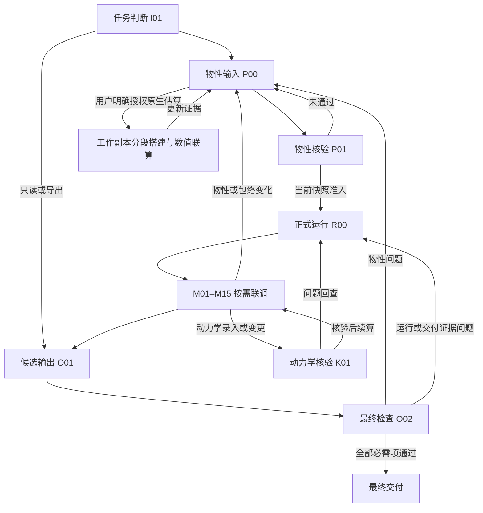

# Aspen Plus Automation Skill

**以化工原理为起点，把流程搭建、排错、物性与动力学检查、结果输出和交付验收连接成完整工作流。**

这是面向 Codex 的 Windows 本机 Aspen Plus 自动化技能，由陆小果维护并免费分享。技能通过可用的 COM（`Apwn.Document`）或 MCP 工具操作用户本机的 Aspen Plus；既提供执行方法，也规定什么时候检查、检查什么、发现问题后回到哪里修复。

当前采用**同一会话中的多模块工作流**。M01–M15 是可互相调用的工艺与实现模块，P00/P01 负责物性输入、验证与准入，K01 负责动力学录入后的即时核验，O02 负责最终检查。独立复算通过模型副本与新 COM 会话完成。

作者联系：2582693241@qq.com / luxiaoguo0225@gmail.com。**仅供学习交流，非作者本人严禁用于售卖等商业用途。** 软件商标、案例和授权边界见 [NOTICE.md](NOTICE.md)。

## 1. 适用任务与完成标准

| 任务 | 工作重点 |
|---|---|
| 从要求搭建或扩展流程 | 明确边界与验收指标，选择物性和反应模型，建立设备与接口，再运行、检查和交付 |
| 修复已有模型 | 保护原件与用户最新 PFD，从实际输入、状态和日志定位原因，调用相关工艺模块修复并复算 |
| 核验物性或动力学 | 检查真实生效的数据源、公式、单位和范围，用原始文献、物性数据及可比工业数据验证 |
| 读取、导出或复算 | 保留实际任务范围与来源身份，输出所需文件、数据、图表及对应证据 |

任务是否完成由用户要求和当前证据决定。文件能打开、计算收敛、物性适用、设备具备能力、冷重开可复现和文件包完整，是分别需要证明的结论。

## 2. 总体工作流

**任务判断 → 物性输入与准入 → 分段运行与联调 → 候选输出 → 最终检查。**



### I01：先判断任务，再冻结要求

区分“搭建流程类”和“解决报错类”，再确定主模块与相关模块。混合任务保留两类目标；读取、解释、导出等辅助动作按实际范围处理。

记录原始文件、允许修改范围、禁止项、用户最新 PFD、目标指标、交付清单和验收办法。未知项作为假设或缺口记录，不能为通过检查删掉要求或降低门槛。入口：[I01任务判断](modules/intake.md)。

### R00：按原理组织运行与排错

先读取相关教材原理，形成当前任务的模型、参数、单位、接口和独立验算判断，再参考案例实现。M01–M15可以多次联调；出现异常立即进入M15，按根因返回物性、反应、设备、收敛或接口模块。

按工段传递真实出料并核验后接入，优先在上游通过原生分离单元建立杂质净出口，逐塔回读活动规格和操纵变量。每轮保留输入版本、实际设置、运行身份、新日志、结果和未解决项。输入或接口变化后，刷新受影响证据，不能沿用旧结果。入口：[R00运行模块](modules/run/index.md)。

### O01：先形成候选输出

按要求组织原生可编辑文件、数据、图表、报告和来源说明。模型、数字和图表应对应同一最终工况，不能把旧结果拼入新交付。输出仍是候选，必须进入内部O02检查。入口：[O01输出模块](modules/output/index.md)。

### O02：检查决定交付或回流

逐项核用户要求、实际执行、日志、物性与参数、独立衡算、冷重开、图形/设备要求及包一致性。有错误、未达标、证据不足或过期，携问题清单回R00：**修复 → 新运行 → 新输出 → 再检查**。

真正缺少外部数据、许可或物理依据时，保留未通过项并说明边界，不能删要求、改阈值或编造通过。入口：[O02检查子模块](modules/output/check.md)。

## 3. M01–M15：同级互通，按任务组合

模块按问题与接口组合使用，可直接调用登记的相关模块，也可经R00调度。M15与其他模块同级，负责组织取证、诊断和修复联调。

| 模块 | 内容 |
|---|---|
| [M01](modules/run/M01-properties-and-boundaries.md) | 需求、物性与流程边界 |
| [M02](modules/run/M02-distillation.md) | 精馏塔与特殊精馏 |
| [M03](modules/run/M03-reactors.md) | 反应器、动力学与多相反应 |
| [M04](modules/run/M04-pressure-transport.md) | 压力输送与压力网络 |
| [M05](modules/run/M05-heat-and-energy.md) | 传热、蒸发、热集成与公用工程 |
| [M06](modules/run/M06-thermal-coupling.md) | 热泵、多效与热耦合 |
| [M07](modules/run/M07-hydraulics-rating.md) | 设备水力学与评级 |
| [M08](modules/run/M08-numerics.md) | 循环、Design Spec、收敛与验证 |
| [M09](modules/run/M09-execution-interfaces.md) | COM、MCP、输入文件与PFD机制 |
| [M10](modules/run/M10-solids.md) | 颗粒分离、固体床与流态化 |
| [M11](modules/run/M11-mass-transfer.md) | 吸收、萃取、干燥、结晶与膜 |
| [M12](modules/run/M12-special-materials.md) | 石油、非常规固体与聚合物 |
| [M13](modules/run/M13-dynamics-batch.md) | 动态、控制、开车与批次 |
| [M14](modules/run/M14-optimization-custom.md) | 经济优化、自定义、ROM与批量 |
| [M15](modules/run/M15-troubleshooting.md) | 报错诊断与修复 |

例如：

- **精馏与热集成**：M01物性/相图、M02塔模型，联动M04压力、M05/M06热量、M07水力、M08收敛和M09实现。
- **动力学反应器**：M03联动M01物性、M04压降、M05反应热、M08数值与M09字段映射。
- **已有流程报错**：M15从当前证据定位原因，再返回对应模块修复；不能用更多迭代或更宽容差替代根因分析。

## 4. 原理与案例如何共同工作

每个运行模块都有输入、原理层、案例层、跨模块接口和输出/返回要求：

1. **先读原理**：确认公式、自由度、单位、物性、动力学、守恒关系和适用边界。
2. **形成当前判断**：区分原始文献事实、推导、假设、拟合和外推。
3. **再查案例**：学习Aspen语法、工具操作和已观察的失败模式，重新核验数值是否适用。
4. **用当前证据检查**：历史案例完成不等于本次任务已通过。

一个原理可关联多个案例，一个案例也可被多个原理和模块引用。教材、案例与诊断正文保留单一实体，通过交叉引用复用；无现成案例也可以据原理推进，不为套用案例改变题目。

导航：[教材来源与章节覆盖](references/textbook-source-coverage.md) · [原理—案例多对多表](references/principle-case-map.md) · [内容归属表](references/content-ownership.md)。仓库不包含整本教材或全文提取；主题覆盖也不等于逐页逐式核验。

## 5. P00/P01 物性前置与 K01 动力学核验

### P01：物性信息录入或修改后

常规模拟选择适合当前工况的物性方法，核对实际必需输入完整且生效，并说明文献依据。Aspen 原生数据与文献拟合值的差异本身不阻断建模。设计规定的目标通常最多四位有效数字，Vary 上下限按可操作范围优先取整或用简洁小数。见 [M02 塔设备设计规范](modules/run/M02-distillation.md#tower-design-specs)。

正式流程先完成 P00/P01 及当前快照准入。用户明确授权时，按 P00 中的输入核对要求使用原生估算，在隔离副本上逐段搭建并做数值联算。工程物性和最终交付的验收分别保留。方法、来源、溶剂、相数或操作范围改变后，重查受影响部分。

| 检查重点 | 具体要求 |
|---|---|
| 二元参数真实来源 | 逐组分对/方向核数据库、版本、记录与实际命中。纯组分库与二元参数库分开，回读来源字段和数值字段 |
| 缺失与0值 | 必需参数缺失或出现无依据的零值时追溯原生来源，必要时换源或重新选型。有模型及记录依据的零值可保留 |
| 0值的含义 | 公式固定为0或明确不参与的结构项须有原始依据，单列说明；不能把未知的0改名为结构项 |
| 科学适用性 | 核模型/相关式、单位、温压/组成范围、适用相，以及VLE/LLE/VLLE、相稳定性和所需焓/气相/输送性质证据 |
| 保存后回读 | 在副本中保存、独立重开，确认生效方法、来源和系数没有丢失或改变；换源后重查相图及受影响计算 |

详见[P00物性输入与原生估算路径](modules/properties/index.md)及[P01物性检查](modules/properties/check.md)。精馏搭塔前还需进行适用的[相图分析](references/phase-diagram-before-distillation.md)。

### K01：动力学录入或修改后

先确认物性检查有效，再用独立反应器副本进行实际核算，不能等到全流程搭完才比较转化率和选择性。

- 核原始方程、文献位置、反应网络、计量、单位、A/E/Tref、反应相和催化/速率基准。
- 在适用温度与组成下，独立计算原文速率并对照Aspen实现，检查温度依赖、驱动力与吸附项。
- 尽量复现原文条件，逐点比较转化率、选择性及必要的收率、温度或轴向轨迹；保留原文值、预测值、差异和有据阈值。
- 对照有来源且条件可比的工业或中试数据，明确单程/全厂、摩尔/质量/碳基、净生成量等口径；不同条件不能直接混比。
- 核副反应及副产物去向。仅有主反应时天然得到的“100%选择性”不能充当工业验证。

不符时返回相关模块，修正实现或选择更适用的有据动力学，再录入、运行和检查。不能任意调A/E、规定转化率或人为分配结果凑目标。详见[K01动力学检查](modules/output/kinetics-validation.md)。

## 6. 继续运行与最终交付的区别

| 工具返回 | 含义 |
|---|---|
| `CONTINUE` | 某个前置阶段检查通过，可以继续本轮；完整任务尚未交付 |
| `RUN` | 有失败、未验证、缺失或过期证据，回运行模块修复和取证 |
| `DELIVER` | 最终合同的必需项全部通过，结论限于实际检查范围 |

最终O02会重新核对前置检查与当前有效设置/范围的子快照，防止换参数后沿用旧PASS。完整模型交付还须按范围检查当前`.his`与Control Panel、实际容差/规格、独立衡算、冷重开、依赖文件及用户要求的PFD或设备证据。

`check_delivery.py`核对合同、文件哈希、运行身份、数值及单位、可识别日志和已登记审查证据。**物性是否科学有效、文献是否可比、设备是否具备能力，仍需实际资料和模型判断。**

记录格式：[输出证据](modules/output/evidence-format.md) · [前置检查格式](modules/shared/validation-stages.md) · [工艺验收](modules/output/process-acceptance.md)。

## 7. 使用环境与安装

- Windows本机，已安装可用的Aspen Plus及所需许可。机制以V14核验经验为基础，其他版本与专用模块逐项确认。
- Python 3.10+；COM操作需要`pywin32`。按实际安装核接口、注册、单位与位宽，避免盲目更改系统配置。
- Codex可读取技能并有本机执行工具。常用动作可走已核验MCP；深层树审计、批量或冷重开可走COM。

全新安装示例；已有副本先备份再更新：

```powershell
git clone https://github.com/luxiaoguo0225/SYUCT-GuoJiaXing-Automated-ASPEN-PLUS-skill.git "$env:USERPROFILE\.codex\skills\aspen-plus-automation"
python -m pip install -r "$env:USERPROFILE\.codex\skills\aspen-plus-automation\requirements.txt"
```

在Codex中调用`$aspen-plus-automation`，提供文件、目标、禁止项和交付要求即可，例如：

```text
使用 $aspen-plus-automation。
模型路径：<你的模型完整路径>
目标：修复当前流程的报错，并核对产品指标。
先备份原件，保留最新PFD和用户禁用状态，不放宽容差。
物性和动力学变更后立即检查。
最终给出原生可编辑文件、实际运行/冷重开证据及未通过项。
```

## 8. 目录和常用工具

```text
.
├── SKILL.md                      # 入口、工作流和全局约束
├── README.md                     # GitHub介绍与使用说明
├── 中文分类索引.md               # 中文导航
├── modules/
│   ├── intake.md                 # I01任务判断
│   ├── run/                      # R00、M01–M15与诊断正文
│   ├── properties/               # P00输入与P01物性检查
│   ├── output/                   # O01、O02、K01与验收
│   ├── shared/                   # 共用约束与阶段格式
│   └── registry.json             # 互调、状态与资料归属
├── references/                   # 原理、来源、案例与兼容导航
├── assets/                       # 历史教学/实现案例资产
├── scripts/                      # COM、日志、证据与结构工具
├── agents/openai.yaml            # 技能显示与调用元数据
└── .github/workflows/validate.yml # 仓库离线CI
```

`agents/openai.yaml`是技能元数据；当前工作流由同一会话按模块推进。

| 工具 | 用途 |
|---|---|
| [aspen_plus_bridge.py](scripts/aspen_plus_bridge.py) | COM打开、读写、运行与另存 |
| [build_from_input.py](scripts/build_from_input.py) | 从输入文件执行并导出模型/报告 |
| [history_check.py](scripts/history_check.py) | 识别日志编码、消息与完成证据 |
| [check_delivery.py](scripts/check_delivery.py) | 核对冻结合同与候选证据，返回运行或交付状态 |
| [validate_modular_skill.py](scripts/validate_modular_skill.py) | 核模块关系、资料归属、真实链接与Python语法 |

这些检查在技能工作流中执行；直接调用独立脚本时，也应显式准备对应合同、输入身份和原始证据。各脚本参数见`--help`。

## 9. 本地验证与GitHub CI

在仓库根目录执行：

```powershell
python -X utf8 scripts/validate_modular_skill.py
python -X utf8 -m unittest discover -s scripts/tests -p "test_*.py" -v
```

CI在push和pull request后运行结构、引用、语法及离线回归，覆盖证据失配、旧日志、指标未达标、前置漏项与失败回流等行为。GitHub托管runner不运行Aspen；具体模型的物性、运行、界面与工业适用性须在本机验证。离线测试通过不等于所有历史案例已重新运行。

## 10. 执行与结论边界

- 保留原件，在副本中编辑和验证；只关闭本次拥有的COM会话。
- 保留最新PFD、真实端口/连线、禁止项和原生Sensitivity等用户指定对象。
- 不放宽求解或验收容差；不写入计算输出，不用SEP人为分配或自定义模块凑分离指标。
- 数值收敛、物性有效、独立复现、设备评级、图形可见和包完整分项验收，明确来源、假设、外推与未验证范围。
- 公开技能只沉淀可复用判断与边界；保密项目的原始数据、参数、拓扑、路径和模型不进入公共技能。

详细约束：[共享建模合同](modules/shared/modeling-contract.md) · [收敛、分离与能量诚信](references/convergence-separation-and-energy-integrity.md)。历史案例数值仅属于其原任务，引用前重新核验条件。
