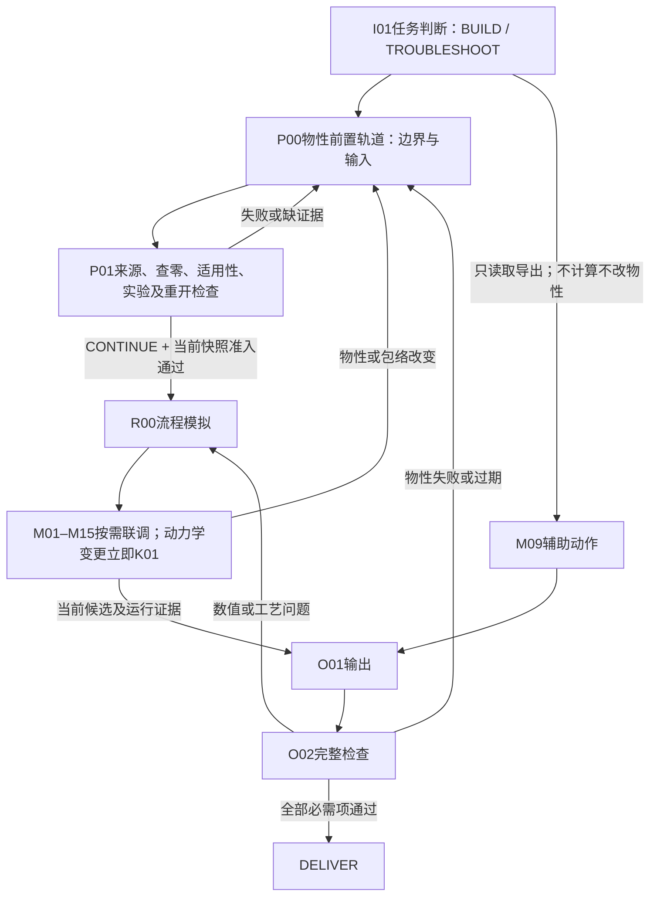

# Aspen Plus 自动化：任务 → 物性前置轨道 → 流程模拟 → 输出与检查

## 1. 调用架构

本技能在同一会话执行，不创建执行/验证子agent。**P00独立核对物性输入与验证，P01通过并核当前快照后进入正式R00。** 用户明确授权的原生估算搭建与数值联算按P00专节执行。独立复算指模型副本与新COM会话复现。

1. 读[I01](modules/intake.md)，冻结搭建/报错目标、范围、禁止项和验收要求；旧模型可先读文件/日志取证，但不能直接复算。
2. 先独立执行[P00物性前置轨道](modules/properties/index.md)：需要二元参数时**先启用全部可用数据源，再逐对查零，随后比较非零候选的体系适用性**。缺失/未知零值不放行；有据固定零项与用户约束分别处理，不为消零拼参数。**物性输入禁止USER，只能使用适用且实际绑定的原生数据库记录；没有合适来源就报告未通过，不转USER。**
3. P00调用[P01](modules/properties/check.md)，五项必需检查全部通过仅CONTINUE；[流程准入脚本](scripts/check_process_gate.py)重验当前物性快照后才进入[R00](modules/run/index.md)。失败留在物性轨道修复，不以“流程已收敛”倒推物性有效。
4. R00联调M01–M15，动力学录入/改变立即[K01](modules/output/kinetics-validation.md)，先有有效物性。任何物性/温压组成包络变更返回P00，废弃受影响旧结果，再验再算。
5. 当前候选进入[O01](modules/output/index.md)并必须调用[O02](modules/output/check.md)。物性问题退P00，其他问题退R00；全部必需项通过才最终交付。纯读任务按冻结范围检查，不借辅助路线运行流程。

复杂回路按[工段实算与接入](modules/run/index.md#section-integration)逐段验收，优先在上游形成真实杂质出口。用户明确允许使用原生估算进行数值联算时，可按[P00 数值诊断](modules/properties/index.md#native-estimate-diagnostic)执行获准范围内的试算，物性验收状态仍保留。

## 2. 运行子模块：同级、互通、原理加案例

| 模块 | 内容 |
|---|---|
| [M01](modules/run/M01-properties-and-boundaries.md) | 需求、物性与流程边界 |
| [M02](modules/run/M02-distillation.md) | 精馏塔与特殊精馏 |
| [M03](modules/run/M03-reactors.md) | 反应器、动力学与多相反应 |
| [M04](modules/run/M04-pressure-transport.md) | 压力输送与压力网络 |
| [M05](modules/run/M05-heat-and-energy.md) | 传热、蒸发、热集成与公用工程 |
| [M06](modules/run/M06-thermal-coupling.md) | 热泵、多效与热耦合 |
| [M07](modules/run/M07-hydraulics-rating.md) | 设备水力学与评级 |
| [M08](modules/run/M08-numerics.md) | 循环、Design Spec、收敛与验证 |
| [M09](modules/run/M09-execution-interfaces.md) | COM、MCP、输入文件与PFD机制 |
| [M10](modules/run/M10-solids.md) | 颗粒分离、固体床与流态化 |
| [M11](modules/run/M11-mass-transfer.md) | 吸收、萃取、干燥、结晶与膜 |
| [M12](modules/run/M12-special-materials.md) | 石油、非常规固体与聚合物 |
| [M13](modules/run/M13-dynamics-batch.md) | 动态、控制、开车与批次 |
| [M14](modules/run/M14-optimization-custom.md) | 经济优化、自定义、ROM与批量 |
| [M15](modules/run/M15-troubleshooting.md) | 报错诊断与修复 |

模块之间不是固定串行顺序；可直接调用登记的相关模块，也可经R00跨模块调度。P00/P01独立位于流程模拟之前，M01/M09/M15可被该轨道调用提供原理、实现和诊断支持；K01仍是动力学录入后的检查。M01–M15保持同级互通。

每个子模块保留输入、原理层、案例层、跨模块接口和输出/返回要求。先读当前相关教材K条目，独立形成方案/根因判断，再查案例机制。一个原理可以关联多个案例，一个案例可被多个原理和模块共同调用，关系见[原理—案例双向表](references/principle-case-map.md)。无案例不阻止有据建模；不为套案例改题目。

RPlug 参数优化或仅限原生 Sensitivity 的复做，按需读 [专项方法](references/rplug-native-sensitivity-method.md)，并通过 M03/M14 与 M09/M15 联调；此专项不替代其他任务的工具与目标选择。

萃取精馏任务按需读[研究与模拟路径](references/extractive-distillation-workflow.md)，经P00/M01物性、M02两塔/溶剂回收、M08循环及M09原生来源贯通；报错转[M15专项](modules/run/diagnostics/extractive-distillation-fixes.md)。案例C23只继承机制，不继承本次未通过的物性、参数、最优点或工程结论。

共享教材/案例保留单一正文，各模块引用；专门排错文档和混合文档中的修复章节归入M15，原位置只保留跳转。全部资料的主要归属及共享用途见[内容归属表](references/content-ownership.md)。

## 3. 全流程不变量

- 用户目标、禁止项、验收阈值、交付内容和最新PFD优先；用户给定目标不是物理可行证据。新建用原生默认排布，修复保留用户现有排布与真实端口/连线。
- **物性输入禁止USER。** 纯组分、二元交互、Henry、电解质等物性参数不得手工覆盖、自行回归后写入或经INP重导入变成USER；文献用于核验与择源，不作为转USER的许可。不能靠改标签或把自填数据包装成数据库绕过；已有USER只可读取诊断，必须恢复适用原生来源后重验，来源不明同样不放行。
- 原理、公式、物性、动力学、单位和参数必须可溯源；文献事实、推导、假设、拟合及未核验外推分别记录。[共享约束](modules/shared/modeling-contract.md)、[教材来源](references/textbook-source-coverage.md)。
- 不得放宽求解或验收容差，必须核实际生效值；Custom/OTHERS仅在当前允许范围内、有数值诊断和复算支持时使用。不得用SEP人为组分分配、自定义模块或写入结果凑分离指标。[诚信边界](references/convergence-separation-and-energy-integrity.md)。
- 精馏搭塔前先物性核验与[相图分析](references/phase-diagram-before-distillation.md)；关键物性、压力或溶剂改变后重核相关判断。属性换库、来源或适用包络变化统一退回P00，经M01/M15修复并重验后再进入流程模拟。
- 编辑和验证在副本中进行，不在交付目录初始化；保留原件和交付字节。只关闭本次拥有的COM会话，不影响用户/未知实例。接口、版本、许可和专用模块能力按本机核验。
- COM与MCP共用同一原理和验收；常用操作可用已核验MCP，复杂审计/批量/冷重开可用COM，接口成功不等于模型有效。细节由M09管理，不擅自重配环境。
- 数值收敛、物性有效、独立复现、水力/设备评级、图形可见和包完整分开验收。日志/Control Panel仍需零Severe/Error/Warning；缺证据不能通过。
- 保密项目只沉淀通用判断与边界，不加入原始参数、具体拓扑、模型、数据、路径、日志或其编码副本。

## 4. 执行与交付记录

I01冻结用户要求和必需检查；P00记录来源启用、逐对查零、候选适用性、原生保存重开、P01及当前快照准入；R00每轮记录实际调用模块、原理/案例、输入/设置、run_id和结果证据；O01形成当前候选；O02检查并输出DELIVER或返回RUN的问题清单。修复导致输入/接口变化时使关联旧证据失效，重新取证。

遇到同一原因不要无依据反复运行，先更新诊断。确实缺少外部数据/许可/权限或目标物理不可行时，完成可独立推进部分并报告未通过要求和证据，不能删要求或改门槛；这是明确的未完成边界，不是默认验收通过。

原有K/C编号、来源覆盖与案例证据等级保留；本次内容重组不声称重新运行所有案例。机器可读结构见[registry.json](modules/registry.json)，维护后执行`scripts/validate_modular_skill.py`和相关离线回归。
