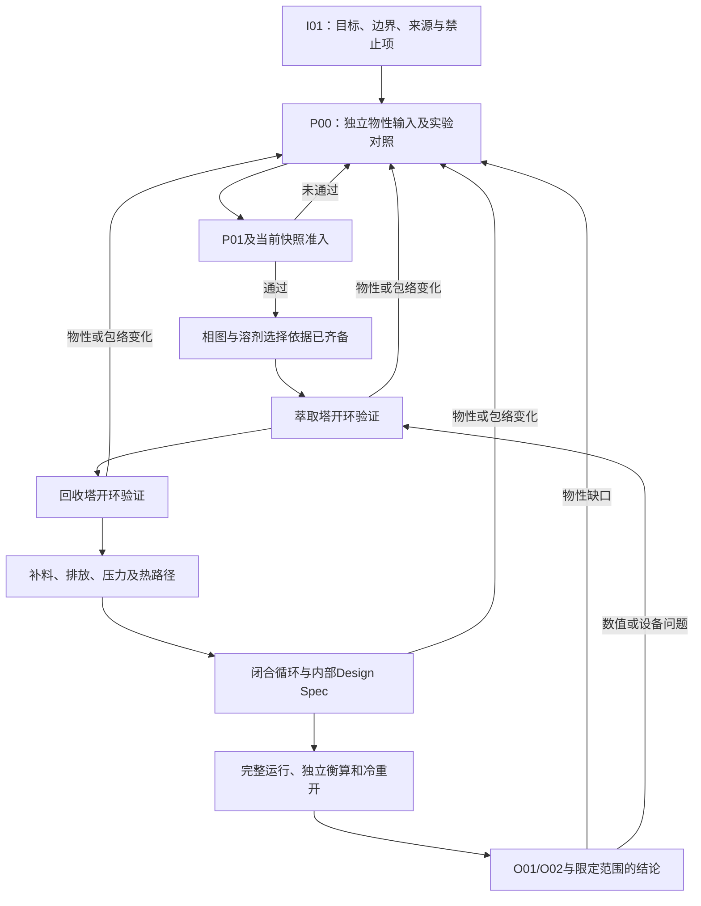

# 萃取精馏：研究、物性、建模与闭环验证路径

维护：M02；共享P00/M01/M05/M07/M08/M09/M15/O02。案例编号[C23](principle-case-map.md#c23)。先读[M01物性原理](textbook-properties-and-boundaries.md)、[M02特殊精馏原理](textbook-distillation-and-towers.md)，再复用本路径。

本文保存方法和可复用接口，不提供可直接套用的塔板数、进料板、回流比、溶剂比、二元系数或成功模型。某次数据库记录、数值收敛或单塔完成不能证明整个流程已验证。

## 1. 适用范围与总体路线

适用于用选择性溶剂改变相对挥发度的萃取精馏，通常需要萃取塔、溶剂再生/回收和循环。先区别液液萃取、共沸精馏、变压精馏和混合溶剂路线；不能因为某模板有“萃取”就套用其单元或拓扑。



相图和独立物性计算属于P00验证的一部分；图中不是P01先通过、事后才补热力学可行性。P01未通过只可继续隔离的物性诊断，不运行依赖它的单塔或循环流程。

## 2. 文献与数据路径：先取得可核验的数据

搜索对象应同时包含“目标二元体系”“溶剂与两个原组分的二元体系”“三元/多元体系”“操作压力”。提取实验T/P/x/y、相数、组分身份、测量方法与不确定度，而不只摘抄一张流程图或文中的最优回流比。分别标记实验事实、作者拟合、作者模拟、自己的推导和未核验外推。

对乙醇–水–乙二醇这一公开学习体系，可从以下原始研究的数据入口开始：

| 来源 | 能支持什么 | 不能据此声称什么 |
|---|---|---|
| [Kamihama等，2012，DOI 10.1021/je2008704，NIST ThermoML](https://trc.nist.gov/ThermoML/10.1021/je2008704.html) | 同一压力下三组二元及三元VLE，适合成套比较泡点/气相组成及多元预测 | 不自动覆盖所有高温、富溶剂区、焓和输送性质 |
| [Pla-Franco等，2013，DOI 10.1016/j.fluid.2012.12.022，NIST ThermoML](https://trc.nist.gov/ThermoML/10.1016/j.fluid.2012.12.022.html) | 乙醇/水与乙二醇或甘油的三元实验，可作为另一个候选数据来源 | 未实际计算对照前不算已经通过的外部验证 |
| [AspenTech原编Physical Property Data，数据库章节](https://sites.chemengr.ucsb.edu/~ceweb/courses/che184b/aspenplus/Physical%20PropData.pdf) | 解释VLE-IG/RK/HOC等与气相框架的关系，以及库内数据范围/拟合质量的意义 | 旧版手册不能代替当前V14安装的具体记录 |

在ThermoML页面沿JSON/XML链接读取数据，按文章内组分编号重新绑定CAS/名称；不同文章的编号不可通用。明确K/°C、Pa/kPa/bar、摩尔/质量分数及液/气相，不用四舍五入后的图像值代替可用原始表。下载、解析和对比放项目工作目录；公开skill仅保存方法和文献入口。

## 3. P00：完整体系选源及验证

完整规则以[P00](../modules/properties/index.md)和[P01](../modules/properties/check.md)为准。本专项增加以下萃取精馏判断：

1. 包络同时考虑萃取塔各段、溶剂回收塔、富溶剂塔底、冷却/混合与循环。溶剂是少挥发组分不等于其交互作用不重要；不能只在原料或塔顶温度验参。
2. 需要三组二元记录时全部展开并审计两个方向；多溶剂、杂质或其他相态需要增加相应记录，不能因缺数据删掉组分。全选当前可用二元源后，先查零、缺项及默认回退，再比较适用来源。物性禁止USER/手工覆盖/自行回归写入；没有合适原生库记录就保留未通过，不用文献数值替代录成USER。
3. 候选的非零性与合理性分别判断：气相框架、NRTL/UNIQUAC温度形式、VLE/LLE用途、T/P/x范围、原始拟合质量和实验误差都要匹配。一个组分对用完整记录，不为消零在一对内部拼库；不同对选择不同来源后重验三元预测。
4. 对NRTL/理想气相，只在兼容候选内比较，不能把RK/HOC回归记录直接当同一套数值。若确需换气相模型，作为完整方法变更回P00重验，而非只替换某些系数。
5. 拟合质量阈值在比较前按实验精度和任务冻结，不把本案例阈值当通用常数。比较温度和气相组成的RMSE、最大偏差及分区偏差；二元通过不免除三元验证。参加选源/拟合的数据不能再称为未参与选择的外部验证。
6. 用Aspen原生泡点/相平衡分析或隔离Flash模型重现实测条件。若用很小但非零的气化率近似泡点，明示该近似，回读真实相态及液相组成，核近似误差和小流量数值精度；不能把Run2返回当作有效比较。
7. 核VLE/LLE/VLLE、相稳定性及所需焓、输送和气相模型证据。纯组分蒸气压正确、泡点拟合好或温区标签较宽，都不能单独证明混合物热负荷可靠。未解决的零项/高温外推保留FAIL或UNVERIFIED。

**来源选择的经验边界：** 同一个库可能对某一对更好、另一对更差；参数非零的整库也可能实测偏差较大。最终应保存逐体系比较表，而不是沉淀“乙醇体系一律选某库”或“某库品牌更可靠”的规则。

## 4. COM与原生文件路径

以下是V14中核验过的NRTL接口机制，调用前在当前安装及副本确认节点/集合语义，不推广为所有物性方法的通用树结构：

```python
node = doc.Tree.FindNode(
    r"\Data\Properties\Parameters\Binary Interaction\NRTL-1\Input\BDBANK\NRTL"
)
available = node.AttributeValue(5).Value.splitlines()
enabled = [element.Value for element in node.Elements]
```

这里枚举/读取来源，不是完成选择或物性验收。属性返回值可能仍是COM节点，先取Value再转普通数据；版本不支持时明确记录，不假定源已全选。数量和库版本从安装读取，不能硬编码某次安装的库数。

- **选择与生效分别取证。** 原生BKP的NRTL记录中BDBANK保存启用源，CID1/CID2定位组分对，VAL字段保存所选来源；展开INP可用来核数值，但可能不保留库绑定。逐对、逐方向关联两者，不根据多维COM集合扁平化后的Name推断组分对。
- **在整组记录上换源。** 优先已核验COM接口；必要时以同版本原生导出为模板，限定NRTL段，保持编码、续行、单位、其余工艺和图形区。不要把解析系数重建成USER后再声称“仍选数据库”，也不能只更换显示来源文字。
- **保存与独立重开。** 在工作副本导入、清除/废弃旧结果、原生保存后，用新COM会话和另一工作目录重开；核全源启用、逐对命中、系数/单位/范围及全局/局部方法都一致。只关闭本次拥有的COM实例。
- **原生数值求解路径。** 强非理想体系可将原生AZEOTROPIC预设、Newton和相符初始化作为有据候选，回读实际预设/算法/初始化/相数/容差再判断。它不是选溶剂、修物性或稳定收敛的万能设置；循环算法及塔内DS算法分别核查。
- **执行准入。** 正式单塔/流程Run2、Engine.Run2、MCP或batch前都执行[P00当前快照准入](../modules/properties/index.md)。用户禁止Computer Use时按COM/MCP/原生文件完成，不为方便回读改用GUI自动化。

建议将项目文件按职责放在 `work/properties/`（源审计、实验、相图、P01）、`work/columns/`（两个开环塔）、`work/recycle/`（闭环）、`work/verification/`（独立重开）及 `outputs/`（冻结候选）。这是组织示例，不是必须使用的绝对路径；不得在交付目录初始化Aspen。

## 5. 相图与萃取塔开环

先按[精馏前相图分析](phase-diagram-before-distillation.md)核共沸点、蒸馏边界、溶剂改变相对挥发度的方向和可达产品区。固定溶剂比例的伪二元VLE、选择性或相对挥发度可作补充，不能取代三元边界和相稳定性。存在液液分相时重新审查相数及分相设备，不能强制单液相来换取收敛。

P01与当前快照准入通过后，先建开环萃取塔：真实原料、独立溶剂进料和两个产品，不先同时闭循环与所有质量规格。对常见高沸点液相溶剂，溶剂进料通常在原料进料之上形成萃取段；实际位置仍由溶剂挥发度、组成剖面、压力、夹带和严格塔验证确定，不照抄本次进料级。

使用原生RadFrac等适用严格模型，先核物料可行采出量和独立自由度，再设级数、冷凝器/再沸器、压力剖面、进料状态和合理初始化。明确Aspen级数是否包含冷凝器/再沸器、理论级与真实塔板/效率的区别。不得用SEP/指定组分分配替代溶剂改变相平衡的预测。

验证塔内T/x/y、溶剂分布、干板/相数、回收率、溶剂夹带及热负荷；低回流比不等于低汽液负荷。解不合理先诊断物性、规格、压力和相正确初值，不盲目加板或放宽容差。详见[M15失败路径](../modules/run/diagnostics/extractive-distillation-fixes.md)。

## 6. 回收塔、补料与循环闭合

1. 用已经验证的萃取塔底流作为回收塔开环边界，保留真实杂质与溶剂组成；回收塔需重新核富溶剂区物性/焓与热敏温度。若真需减压等工艺变更，先论证并更新包络/P01，不擅自改变用户设计值。
2. 回收溶剂经必要的冷却、输送、补料及混合再返回；核温度、绝压与全压力闭合，不能靠MIXER凭空升压。冷却、再生、公用工程和泵功纳入边界。
3. 补料应调节真实新鲜流股输入。若用原生Calculator，按溶剂**组分摩尔流量**而非循环总流量计算库存需求，核执行先后和唯一变量所有权；输出值不得手写。负补料说明库存/排放/规格矛盾，不静默截成0掩盖问题。
4. 有水、轻组分或杂质积累时设计有物理依据的排放/再生路径，逐组分证明稳态可闭合；不能只平衡主溶剂，也不为让模型闭合虚构损失。
5. 两个开环塔分别通过后再闭循环，按真实相态、组成与温度选撕裂和初值；核原生收敛算法及实际容差。逐步恢复塔内Design Spec及Vary，检查每个独立质量/回收规格是否有独立操纵量，避免固定采出量/RR与同义DS互相争用。

若边界确为“一股新鲜补料 + 一股实际返回溶剂流”，可用 `F_fresh,total=(F_target,S-F_recycle,S)/z_fresh,S` 作为补料输入关系；所有F保持同一摩尔流量单位，S为目标溶剂，回流取排放/回收之后真正返回混合器的组分量，新鲜溶剂分数须大于0。多股回流、混合溶剂或多重库存目标需重新列独立组分衡算，不能照搬一条Calculator关系。

详细数值诚信见[收敛与分离验证](convergence-separation-and-energy-integrity.md)。本次实现机制不授权照抄级数、溶剂流量、初值或Calculator目标库存。

## 7. 筛选、优化与最终验收

只有当前物性与基准闭环通过，才扫描溶剂比、回流比、进料级、级数、溶剂温度/压力及合适的质量规格。每点核真实执行、收敛、质量/回收/溶剂夹带/负荷；失败点单列，不插值成有效结果。用户给定RR或其他上限逐点淘汰，旧任务中的某个上限不能写成所有萃取精馏的通用常数。

Boilup或回流比须带原生定义、基准和单位；回收塔少量塔顶或塔底会让比值异常，不能只凭小分母证明负荷合理。同时读汽/液流量剖面、内循环、溶剂循环量、再沸器/冷凝器热负荷及设备能力。能源比较包含萃取和回收、溶剂预热/冷却、压力输送与其他公用工程，并保持产品纯度、回收率、产能和边界相同。

O02至少核：当前P01及准入、原生来源与有效设置、完整最终运行、输入完整与活动对象、零Severe/Error/Warning、总量/逐组分/能量/压力衡算、溶剂新鲜/回收/排放/夹带闭合、独立目录新COM复算，以及用户要求的PFD/水力/可操作性。参数/范围改变后不得沿用旧结果。只能称“已完成物性诊断”“单塔数值通过”或“完整闭环通过”等实际证据层级，不能用一项DELIVER代替整体物性/工程验收。

## 8. C23的已学到内容与未完成边界

本次公开学习案例支持复用：数据库枚举与完整组分对比较、近泡点/气相组成验证、原生来源绑定保存重开、分步两塔与循环求解的实现思路、物性失败的准入拒绝。这是H机制证据；不是标准工艺包。

本次仍有零值依据、高温/组成适用范围及所需混合物物性未闭合；因此不能把既有数值收敛、实验区筛选通过或文件冷重开提升为全流程物理/工程有效。案例标记**H机制 + U物性/工程**，不附项目模型、源系数、运行结果、工作目录或推荐最优点。
